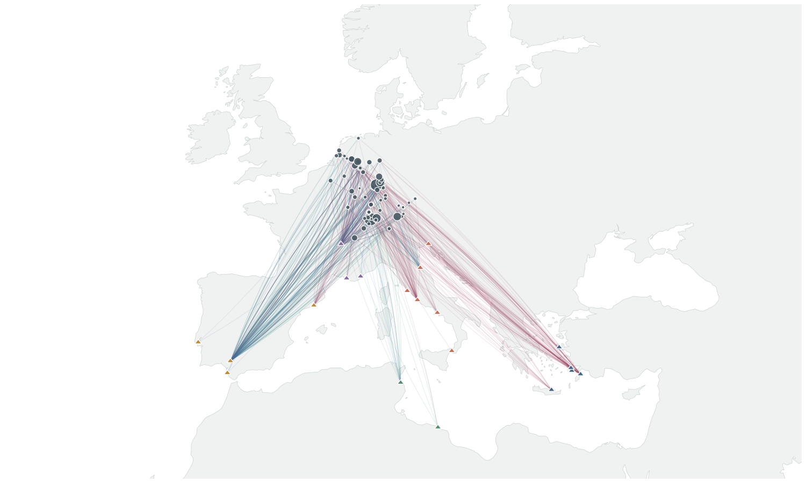

# Theory-Driven Network Backbones for Bipartite Projections

Code, data, and experimental results accompanying the study *Theory-Driven Network Backbones for Bipartite Projections*. 

**Preprint:** arXiv link to be added.

## Overview

Theory-Driven Network Backboning (TDBB) extracts informative connections from a bipartite network by incorporating a data-generating model \(M\) (the “theory”) describing how the observed connections arise. The resulting backbone is therefore interpreted relative to the encoded theory, rather than relying solely on data-agnostic structural or statistical backboning methods.

Simulation-Based Inference (SBI) calibrates the model M to the bipartite data; posterior-predictive simulations provide a model-based reference for scoring projected links.


## Synthetic experiments

Synthetic bipartite networks combine a gravity-based interaction model with latent projections generated using stochastic block models. The experiments compare the theory driven backbones (TDBB) with noise-corrected (NC), disparity-filter (DF), and naive projections using ROC and precision–recall curves.

The `backboning_and_synthetic/` directory contains the generator (`01_make_synth_data.py`), backbone evaluation (`02_run_backbone.py`), and curve aggregation (`03_aggregate_curves.py`). Run the first two scripts for each independent realization, then aggregate the results with the third script. The study uses 100 realizations. Start with empty `pr_curves.tsv` and `roc_curves.tsv` when generating a new set of experiments, since evaluation appends to these files.

## Archaeological case study

The case study examines the distribution of 131 Roman amphora types across 79 archaeological sites, using RAAD amphora records, estimated site populations, and ORBIS transport times. The pipeline builds a bipartite amphora–site network, calibrates a Huff spatial-choice model, and scores site–site connections relative to posterior-predictive simulations.

### Amphora-choice model

For site `i` and amphora type `a`, utility is

`u(i,a) = ASC(major_region(a), good(a)) - beta * log(ORBIS_time(i, origin(a)))`.

A softmax over all 131 types at each site gives `p(type | site)`. Weighting by site population and normalizing across sites for each type gives `p(site | type)`. A multinomial simulator allocates each type's observed total across sites. SBI uses the resulting type-normalized site fractions. The model estimates 11 region–good constants (with one reference constant fixed at zero) and one shared transport coefficient.

### Interactive map



[Interactive archaeological map (HTML)](illustrations/Interactive_map.html)

## Repository structure

- `RUN_CASE_STUDY.py` — configure and execute the archaeological pipeline from a Python IDE.
- `case_study/data/` — RAAD and ORBIS inputs, preprocessing, and processed data; see [`data/raw/README.md`](case_study/data/raw/README.md) for the RAAD column descriptions.
- `case_study/abms/huff_amphora_choice.py` — Huff choice probabilities and multinomial simulator.
- `case_study/experiments/` — SBI, posterior-predictive checks (PPC), simulation-based calibration (SBC), backboning, baseline comparisons, and plotting scripts.
- `case_study/outputs/` — preprocessed archaeological matrix and experiment outputs.
- `backboning_and_synthetic/` — synthetic-data generator, backboning algorithms, evaluation, and results.
- `illustrations/` — method diagram and interactive archaeological map.

## Data construction

The travel cost was acquired from Orbis ( https://orbis.stanford.edu/) using the following parameters:

Origin site was selected based on the original RAAD dataset (https://github.com/Tom-Brughmans/RAAD), as follows: 
• Origin_h1 and origin_h2 values were mapped to placenames used in Orbis
• If there is a place in origin_h2 then use that as the origin. Adriatic = Ariminum; 
Burgundy = Massilia; calabria = regium; campania = Neapolis; Crete = Chersonasos; etruria = Cosa; frejus = Forum Iulii; guadalquivir = hispalis; lusitania = Olisipo; Lyon = Lugdunum; marimbas = Hispalis; marseille = Massilia; north = Aquileia; south = Hispalis; Tarraconensis = Barcino; Tripolitania = Lepcis Magna; Marismas=Gades. These values are informed by origin of amphorae as mentioned in ADS Southampton amphora database https://archaeologydataservice.ac.uk/archives/view/amphora_ahrb_2005/index.cfm
• If there only is a place in Origin_h1 then use the following towns: em = Rhodes; Gaul = Lugdunum; Italy = Ostia/Portus; northafrica = Hadrumetum
• Calculated number of days for each combination of origin and destination site 
using these settings in Orbis: Route= summer; priority=cheapest; network modes all options; road=wagon (oxcart), river=civilian, sea=daylight, transfer cost = 0.
• The value derived from this was placed in the field transport_time. This indicates transport in days.
• There were instances where the “site_name_ancient” as the destination was not part of the ORBIS dataset. In this instance, an additional column was made “ORBIS_alt_site_name” where an alternative site from Orbis was used as the destination point. This site was determined by comparing the Lat./Long. of the original “site_name_ancient” with those in ORBIS and selecting the ones that more closely matched these geographic coordinates. Those sites are listed in the column in lieu of the original “site_name_ancient” sites under the assumption that travel cost in days would have been comparable

For population, the process was a bit different. This was checked against the Hanson & Wilson papers. Other population estimates that could not be extracted from these sources required additional literature review performed by using Google Scholars Lab and chasing sources on Pleiades, DARE, Vici and university libraries. The numbers extracted are from citations that are listed in the RAAD data excel under Column Source_population_Estimate. 

Remaining sites where population could not be determined, were left empty. To mitigate this missing data, we added another column (see list of column attributes) with “population_ unknown (mean)” in which we used the average of known population estimates for all those sites where we do not know the population. This column “Population_unknown (mean)” holds the average value of all known population estimates (7126), only for those sites which do not have a value in the column “population”. 


## Run the archaeological pipeline

Install the Python dependencies from the repository root:

```bash
pip install -r requirements.txt
```

Open `RUN_CASE_STUDY.py` in a Python IDE and select the stages to run. Set `CHECK_ONLY = True` for a quick input and model-dimension check. The default experiment configuration uses 5,000 training simulations, 2,000 posterior samples, 1,000 PPC draws, 100 SBC runs (200 samples each), and 1,000 backbone draws (seed 0).

The individual scripts are also available in `case_study/experiments/`. Preprocessing is provided in `case_study/data/amphora_bipartite_construction.py`.

## Citation

Please cite the associated arXiv preprint of *Theory-Driven Network Backbones for Bipartite Projections*. 
A direct link and citation details will be added when the preprint is available.
